  

  
  
  
  
  
  

---

# ⚡ Awesome Service Proxies: High-Performance L4/L7 Reverse Proxies, Load Balancers & API Gateways 🌐

> A comprehensive, production-grade curated index of **Layer 4 & Layer 7 Service Proxies**, **Reverse Proxies**, **Application Delivery Controllers (ADCs)**, **API Gateways**, and **Cloud-Native Ingress Controllers**. Designed for platform engineers, Site Reliability Engineers (SREs), system architects, and DevOps professionals optimizing high-availability traffic routing, automated TLS termination, and distributed service discovery.

---

## 📑 Table of Contents
- [🔍 Architectural Overview](#-architectural-overview)
- [📊 Sector Overview & Market Dynamics](#-sector-overview--market-dynamics)
- [🏢 SaaS & Managed Cloud Service Proxies](#-saas--managed-cloud-service-proxies)
- [🐙 Open-Source GitHub Projects](#-open-source-github-projects)
- [⚖️ Architectural Comparison & Selection Matrix](#️-architectural-comparison--selection-matrix)
- [🤝 How to Contribute](#-how-to-contribute)
- [⭐ Star History](#-star-history)
- [💖 Support & Community](#-support--community)
- [📜 Disclaimer & License](#-disclaimer--license)

---

## 🔍 Architectural Overview

**Service Proxies** sit strategically between clients and backend microservices, operating as the frontline data plane of modern distributed architectures. They execute critical infrastructure responsibilities:
- **Layer 4 (Transport) Load Balancing**: High-throughput, connection-level TCP/UDP routing with millisecond latency and minimal CPU overhead.
- **Layer 7 (Application) Reverse Proxying**: Context-aware HTTP/1.1, HTTP/2, HTTP/3, gRPC, and WebSocket steering based on headers, paths, cookies, and query parameters.
- **Zero-Trust Security & TLS Termination**: Automated Let's Encrypt certificate issuance, mutual TLS (mTLS), DDoS shielding, and Web Application Firewall (WAF) filtering.
- **Dynamic Service Discovery & Observability**: Real-time upstream health checking, distributed tracing (OpenTelemetry), live traffic shaping, rate limiting, and zero-downtime hot reloads.

---

## 📊 Sector Overview & Market Dynamics

The global **Application Delivery Controller (ADC), Service Proxy, and API Gateway market** is currently valued at approximately **$4.8 billion in 2024–2025** and is projected to expand to **$11.2 billion by 2032**, demonstrating a Compound Annual Growth Rate (CAGR) of **11.5%**.

### 📈 Market Structure & Fragmentation
The market exhibits a unique **dual-tiered competitive dynamic**:
- **Moderately Concentrated Enterprise & Edge Infrastructure Layer**: The enterprise hardware and hyperscaler cloud load balancing tier is dominated by cloud titans (AWS, Google Cloud, Microsoft Azure) and established networking leaders (F5 Networks, Cloud Software Group/Citrix, Cloudflare). These providers control significant market share due to bundled cloud billing, enterprise compliance assurances, and massive globally distributed Anycast Points-of-Presence (PoPs).
- **Highly Fragmented Cloud-Native Application & Ingress Layer**: At the container, Kubernetes, and edge application tier, the market resists a winner-take-all outcome. Open-source solutions (such as **Caddy, Traefik, Kong, NGINX, Envoy, HAProxy, and Apache APISIX**) command massive developer adoption. This layer is fiercely competitive and anti-monopolistic, driven by engineering demand for vendor neutrality, protocol innovations (HTTP/3, gRPC, WebAssembly filters), and high-performance Rust/Go implementations.

---

## 🏢 SaaS & Managed Cloud Service Proxies

The table below catalogs leading managed cloud load balancers and commercial application delivery controllers, **sorted descending by company size** (market capitalization or institutional valuation).

| 🏢 Product | 🏷️ Vendor / Parent | 💰 Company Size (Valuation / Revenue) | 🏷️ Starting Tier Pricing | 🎁 Free Tier / Trial Limit | 🚀 Primary Capabilities & Use Cases |
| :--- | :--- | :--- | :--- | :--- | :--- |
| **[Google Cloud Load Balancing](https://cloud.google.com/load-balancing)** | Alphabet Inc. (NASDAQ: GOOGL) | **~$2.2 Trillion** MCap (~$40B+ Google Cloud revenue) | **$0.025 / hour** for first 5 forwarding rules (~$18.00/mo) + $0.008–$0.012 per GB | **$300 free trial credits** valid for 90 days across GCP; no permanent free forwarding rules | Global Anycast VIP with single frontend IP, cross-region auto-failover, native integration with Cloud Armor WAF and Cloud CDN. |
| **[AWS Application Load Balancer (ALB)](https://aws.amazon.com/elasticloadbalancing/application-load-balancer/)** | Amazon Web Services (NASDAQ: AMZN) | **~$2.1 Trillion** MCap (~$105B+ AWS annual revenue) | **$0.0225 / hour** (~$16.20/mo base) + **$0.008 per LCU-hour** consumed | **750 hours/month** shared between ALB/CLB + 15 LCUs/mo for 12 months on new AWS accounts | Dedicated Layer 7 HTTP/HTTPS/gRPC proxying, advanced path/host-based routing, target groups for EC2, ECS, EKS, and AWS Lambda. |
| **[AWS Network Load Balancer (NLB)](https://aws.amazon.com/elasticloadbalancing/network-load-balancer/)** | Amazon Web Services (NASDAQ: AMZN) | **~$2.1 Trillion** MCap (~$105B+ AWS annual revenue) | **$0.0225 / hour** (~$16.20/mo base) + **$0.006 per NLCU-hour** consumed (~25% cheaper data cost) | **$300 AWS Activate credits** for startups or standard 12-month tier; no permanent standalone free tier | Ultra-high throughput Layer 4 TCP/UDP balancer capable of handling millions of requests/sec at sub-millisecond latency with static Elastic IPs. |
| **[Cloudflare Load Balancing](https://www.cloudflare.com/application-services/products/load-balancing/)** | Cloudflare, Inc. (NYSE: NET) | **~$38.0 Billion** MCap (~$1.7B annual revenue) | **$5.00 / month** flat base (includes 2 origin servers, 60s health checks; +$5/mo per extra origin) | **Free Forever Core Plan** with unlimited CDN/DDoS bandwidth; 30-day enterprise trial for Load Balancing | Global Server Load Balancing (GSLB), multi-region DNS failover, zero-latency steering across 330+ edge PoPs with automatic DDoS protection. |
| **[Citrix ADC (NetScaler)](https://www.netscaler.com/)** | Cloud Software Group (Private / Vista & Elliott) | **~$16.5 Billion** Valuation (~$3.2B annual revenue) | **$15,000 one-time** perpetual (VPX-200) or **$0.58 / hour** PAYG on AWS/Azure (~$420/mo) | **NetScaler VPX Express**: Free Forever limited to 20 Mbps throughput and basic L4-L7 features; 90-day VPX Enterprise trial | Enterprise application acceleration, granular content switching, SSL/TLS hardware offloading, and optimized ICA proxying for virtual desktops. |
| **[F5 BIG-IP](https://www.f5.com/products/big-ip-services)** | F5, Inc. (NASDAQ: FFIV) | **~$15.0 Billion** MCap (~$2.8B annual revenue) | **$6,146 one-time** (VE-200M, 0.2 Gbps) or cloud PAYG starting from **$0.45 / hour** (~$328/mo) | **30-day unrestricted trial** license for BIG-IP Virtual Edition (VE) with up to 10 Gbps evaluation throughput | High-assurance enterprise Application Delivery Controller (ADC), full-proxy architecture, deep programmability via iRules, and Advanced WAF. |
| **[NGINX Plus](https://www.nginx.com/products/nginx/)** | F5, Inc. (NASDAQ: FFIV) | **~$15.0 Billion** MCap (Subsidiary of F5, Inc.) | **$3,500 / year** per instance license (~$291/mo) or **$0.39 / hour** AWS Marketplace PAYG | **30-day free trial** with complete enterprise feature suite, active health checks, dynamic reconfiguration, and 24/7 SLA support | Production software load balancer adding live dynamic API reloads, active upstream health probes, session persistence, and NGINX App Protect WAF. |
| **[Kemp LoadMaster](https://kemptechnologies.com/)** | Progress Software (NASDAQ: PRGS) | **~$3.0 Billion** MCap (~$750M annual revenue) | **$2,400 one-time** (VLM-500) or annual subscription starting from **$980 / year** (~$81.60/mo) | **Free LoadMaster Edition**: Free Forever capped at 20 Mbps with full Layer 7 features; 30-day unlimited enterprise trial | Turnkey mid-market software and virtual ADC featuring integrated web application firewall (WAF), reverse proxying, and pre-configured app templates. |
| **[Fastly Next-Gen Load Balancing](https://www.fastly.com/products/network-services/load-balancing)** | Fastly, Inc. (NYSE: FSLY) | **~$1.2 Billion** MCap (~$550M annual revenue) | **$50.00 / month** flat base package + bandwidth ($0.08–$0.12 per GB egress) | **Free Developer Account**: Up to **$50/month in free usage credits** every month for non-production development | Edge-computed load balancing and real-time cache routing using VCL (Varnish Configuration Language) across Fastly's edge cloud network. |

---

## 🐙 Open-Source GitHub Projects

Below is the definitive collection of open-source service proxies, reverse proxies, and API gateways, **sorted strictly descending by GitHub Stars_Count**. Each entry features an official social Stars_Badge directly linked to the repository's stargazers page.

### 1. [Caddy](https://github.com/caddyserver/caddy) 
- 📝 **Description**: An extensible, cross-platform HTTP/1.1, HTTP/2, and HTTP/3 reverse proxy and web server written in Go. Famous for pioneering **automatic HTTPS certificate provisioning and renewal** by default via Let's Encrypt and ZeroSSL without external dependencies.
- ⚖️ **License**: Apache-2.0
- 💡 **Best For**: Microservice reverse proxying, rapid prototyping, static asset delivery, and environments requiring zero-maintenance automated TLS.
- ⚡ **Key Features**: Human-readable `Caddyfile` syntax, dynamic JSON REST API configuration, native Go plugin architecture, and zero-downtime grace reloads.

---

### 2. [Traefik](https://github.com/traefik/traefik) 
- 📝 **Description**: The leading modern, cloud-native HTTP reverse proxy and ingress controller designed specifically for dynamic container topologies. Integrates directly with Docker, Kubernetes, HashiCorp Nomad, and Consul.
- ⚖️ **License**: MIT
- 💡 **Best For**: Container-first architectures, Kubernetes Ingress, dynamic microservices, and platforms where backends auto-scale dynamically.
- ⚡ **Key Features**: Automatic dynamic discovery without restart, built-in Let's Encrypt wildcard automation, real-time visual web dashboard, circuit breakers, and retries.

---

### 3. [Kong Gateway OSS](https://github.com/Kong/kong) 
- 📝 **Description**: The world's most adopted open-source cloud-native API gateway and AI gateway. Built on top of NGINX and OpenResty with LuaJIT for sub-millisecond request processing latency.
- ⚖️ **License**: Apache-2.0
- 💡 **Best For**: Enterprise API governance, AI/LLM model gateway routing, token authentication, and high-frequency transaction management.
- ⚡ **Key Features**: 95+ modular plugins (JWT, OAuth2, Rate Limiting, CORS), declarative GitOps management with `decK` CLI, Kubernetes Ingress Controller (KIC), and AI Prompt Decorator/Guardrails.

---

### 4. [Nginx Proxy Manager](https://github.com/NginxProxyManager/nginx-proxy-manager) 
- 📝 **Description**: A streamlined, Dockerized web-based administration dashboard built over NGINX, enabling effortless reverse proxy host management, SSL certificate provisioning, and access lists.
- ⚖️ **License**: MIT
- 💡 **Best For**: Homelab enthusiasts, small-to-medium business infrastructure, self-hosters, and teams needing an intuitive GUI over NGINX.
- ⚡ **Key Features**: One-click Let's Encrypt SSL creation, granular user access lists, HTTP/2 and WebSocket forwarding switches, custom NGINX configuration snippet injection.

---

### 5. [NGINX Open Source](https://github.com/nginx/nginx) 
- 📝 **Description**: The foundational web server, reverse proxy, and Layer 4/7 load balancer powering a substantial portion of the global web. Renowned for its event-driven, asynchronous worker architecture.
- ⚖️ **License**: BSD-2-Clause
- 💡 **Best For**: High-concurrency reverse proxying, static file acceleration, SSL/TLS offloading, and rock-solid edge routing.
- ⚡ **Key Features**: HTTP/1.1, HTTP/2, HTTP/3 (QUIC), gRPC streaming, TCP/UDP stream proxying, fast in-memory caching, and Lua/njs programmatic scripting.

---

### 6. [Envoy Proxy](https://github.com/envoyproxy/envoy) 
- 📝 **Description**: A CNCF-graduated, high-performance C++ distributed service proxy designed by Lyft for cloud-native microservice service meshes and universal edge data planes.
- ⚖️ **License**: Apache-2.0
- 💡 **Best For**: Kubernetes service mesh sidecars (Istio, Linkerd), large-scale microservice communication, gRPC transcoding, and AI/LLM traffic routing.
- ⚡ **Key Features**: Dynamic Discovery Services (xDS APIs: LDS, RDS, CDS, EDS), WebAssembly (Wasm) extensibility, rich L7 observability, zone-aware routing, and token-aware rate limiting.

---

### 7. [Cloudflare Pingora](https://github.com/cloudflare/pingora) 
- 📝 **Description**: Cloudflare's ultra-fast, memory-safe asynchronous Rust framework for building programmable proxies, load balancers, and network services that process trillions of internet requests daily.
- ⚖️ **License**: Apache-2.0
- 💡 **Best For**: Platform architects building custom bespoke proxies, high-throughput CDN edges, and systems demanding memory safety with minimal resource overhead.
- ⚡ **Key Features**: Pure Rust async architecture (built on Tokio), native HTTP/1, HTTP/2, and TLS capabilities, zero memory leaks, and 70% lower CPU consumption compared to legacy NGINX setups.

---

### 8. [Apache APISIX](https://github.com/apache/apisix) 
- 📝 **Description**: A top-level Apache Software Foundation cloud-native API gateway and traffic management platform built on OpenResty with an etcd-backed dynamic configuration plane.
- ⚖️ **License**: Apache-2.0
- 💡 **Best For**: Microservice gateways, serverless traffic routing, cross-cloud API coordination, and dynamic plugin hot-reloading.
- ⚡ **Key Features**: Real-time hot-reloading without restarts, multi-language plugin runners (Java, Python, Go, Wasm), automated health checks, canary releases, and OpenTelemetry instrumentation.

---

### 9. [Netflix Zuul](https://github.com/Netflix/zuul) 
- 📝 **Description**: An edge service gateway developed by Netflix that provides dynamic routing, monitoring, resiliency, and security for high-volume consumer traffic.
- ⚖️ **License**: Apache-2.0
- 💡 **Best For**: Large-scale Java/Spring Cloud microservice environments, edge traffic routing, and custom request filtering.
- ⚡ **Key Features**: Non-blocking asynchronous I/O based on Netty (Zuul 2), dynamic Groovy filter hot-loading, adaptive concurrency limits, and circuit breaking integration.

---

### 10. [Tyk API Gateway](https://github.com/TykTechnologies/tyk) 
- 📝 **Description**: An open-source enterprise API gateway written in Go, featuring comprehensive REST, GraphQL, gRPC, and Model Context Protocol (MCP) traffic orchestration.
- ⚖️ **License**: MPL-2.0
- 💡 **Best For**: Universal GraphQL federation, API product management, developer portals, and multi-tenant enterprise gateways.
- ⚡ **Key Features**: Native GraphQL engine, rate limiting, quota enforcement, JSON/XML payload transformations, and external Go/Python/JS/Lua middleware.

---

### 11. [HAProxy](https://github.com/haproxy/haproxy) 
- 📝 **Description**: The industry standard for high-performance, battle-tested Layer 4 and Layer 7 reverse proxying and load balancing. Celebrated for world-record throughput and rock-solid stability under heavy loads.
- ⚖️ **License**: GPL-2.0 / LGPL-2.1
- 💡 **Best For**: High-throughput web traffic, database connection pooling, TCP/UDP L4 balancing, and zero-error Kubernetes ingress.
- ⚡ **Key Features**: 13+ balancing algorithms (leastconn, roundrobin, consistent hashing), Runtime API, Data Plane API, stick tables for DDoS rate-limiting, and benchmarked speeds exceeding 42,000 req/s on Kubernetes Ingress.

---

### 12. [Zoraxy](https://github.com/tobychui/zoraxy) 
- 📝 **Description**: A general-purpose, lightweight HTTP/HTTPS reverse proxy and forwarding tool written in Go with an intuitive and responsive web-based user interface.
- ⚖️ **License**: AGPL-3.0
- 💡 **Best For**: Homelabs, self-hosted web clusters, single-node VPS setups, and small development teams wanting zero configuration overhead.
- ⚡ **Key Features**: ACME automated SSL certificate issuance, basic auth protection, virtual directory routing, geo-IP filtering, and built-in network diagnostic utilities.

---

### 13. [Varnish Cache](https://github.com/varnishcache/varnish-cache) 
- 📝 **Description**: A specialized HTTP accelerator and caching reverse proxy designed to handle content-heavy web applications by serving responses directly out of memory.
- ⚖️ **License**: BSD-2-Clause
- 💡 **Best For**: Content Delivery Networks (CDNs), news and media publishers, e-commerce storefronts, and API response caching.
- ⚡ **Key Features**: Expressive Varnish Configuration Language (VCL) compiled into native C, Edge Side Includes (ESI) assembly, cache invalidation APIs, and backend load balancing.

---

### 14. [Sōzu](https://github.com/sozu-proxy/sozu) 
- 📝 **Description**: A lightweight, fast, and memory-safe HTTP/HTTPS reverse proxy written entirely in Rust, designed for zero-downtime hot reloads and continuous operational uptime.
- ⚖️ **License**: AGPL-3.0
- 💡 **Best For**: Zero-downtime rolling deployments, multi-tenant PaaS architectures, and security-critical web endpoints.
- ⚡ **Key Features**: Dynamic configuration over Unix domain sockets, process isolation architecture, automatic worker restarts without packet loss, and native TLS support.

---

### 15. [SWAG (Secure Web Application Gateway)](https://github.com/linuxserver/docker-swag) 
- 📝 **Description**: Maintained by LinuxServer.io, SWAG bundles an NGINX web server and reverse proxy with built-in Certbot (Let's Encrypt client), fail2ban intrusion prevention, and authelia/authentik integrations.
- ⚖️ **License**: GPL-3.0
- 💡 **Best For**: Secure home servers, dockerized microservices, remote service publishing, and self-hosted application suites.
- ⚡ **Key Features**: Automated zero-config SSL certificates, fail2ban IP blocking, pre-configured reverse proxy templates for 50+ popular self-hosted apps.

---

### 16. [Skipper](https://github.com/zalando/skipper) 
- 📝 **Description**: An extensible HTTP router and reverse proxy library written in Go by Zalando, built specifically for service composition and large-scale Kubernetes ingress.
- ⚖️ **License**: Apache-2.0
- 💡 **Best For**: Kubernetes Ingress at scale, e-commerce traffic routing, shadow traffic testing, and canary deployments.
- ⚡ **Key Features**: Route matching via predicates and filters, dynamic route updates from etcd/Kubernetes API without restarts, circuit breaking, and OpenTracing support.

---

### 17. [Envoy Gateway](https://github.com/envoyproxy/gateway) 
- 📝 **Description**: The official project managing Envoy Proxy as a standardized Kubernetes Gateway API implementation, simplifying Envoy configuration for ingress and edge proxying.
- ⚖️ **License**: Apache-2.0
- 💡 **Best For**: Standardized Kubernetes Gateway API deployments, replacing legacy ingress controllers, and cross-team multi-tenant traffic routing.
- ⚡ **Key Features**: Direct Kubernetes Gateway API conformance, automated Envoy fleet management, OIDC authentication, rate limiting, and global telemetry.

---

### 18. [KrakenD Community Edition](https://github.com/krakend/krakend-ce) 
- 📝 **Description**: An ultra-high-performance, stateless, declarative API Gateway written in Go. Operates without an external database, aggregating and filtering data from multiple backend services into clean API responses.
- ⚖️ **License**: Apache-2.0
- 💡 **Best For**: Backend-For-Frontend (BFF) patterns, API aggregation, mobile client data miniaturization, and microservice decoupling.
- ⚡ **Key Features**: Sub-millisecond latency throughput, zero runtime database requirements, JSON schema validation, response transformation, and declarative single-file JSON/YAML configuration.

---

### 19. [HAProxy Kubernetes Ingress Controller](https://github.com/haproxytech/kubernetes-ingress) 
- 📝 **Description**: The official enterprise-grade HAProxy ingress controller for Kubernetes, translating Ingress and Gateway API resources into high-speed HAProxy configurations.
- ⚖️ **License**: Apache-2.0
- 💡 **Best For**: High-throughput Kubernetes clusters requiring maximum requests-per-second, predictable latency, and granular ACL control.
- ⚡ **Key Features**: Zero-downtime dynamic service discovery, mTLS certificate validation, Prometheus metrics exporter, and advanced TCP/HTTP health checks.

---

## ⚖️ Architectural Comparison & Selection Matrix

| 🛠️ Technology | 🌐 OSI Layer | 💻 Implementation Language | 🔄 Dynamic Config (No Reload) | 🔒 Automatic HTTPS / TLS | 🏎️ Raw Throughput Rating | 🧩 Extensibility Model |
| :--- | :--- | :--- | :--- | :--- | :--- | :--- |
| **Caddy** | L7 (HTTP/gRPC) | Go | ✅ REST API & JSON | ✅ Native (Let's Encrypt / ZeroSSL) | ⚡⚡⚡ High | Go plugins, Caddy modules |
| **Traefik** | L4 / L7 | Go | ✅ Auto-provider polling | ✅ Native (Let's Encrypt) | ⚡⚡⚡ High | Yaegi Go interpreter plugins |
| **Kong Gateway** | L7 (HTTP/gRPC/AI) | C / Lua (OpenResty) | ✅ Declarative / etcd / DB | ⚠️ Via Cert-Manager / plugins | ⚡⚡⚡⚡ Very High | Lua plugins, Go / Python / Wasm |
| **Nginx Proxy Mgr** | L7 (HTTP/WS) | Node.js / NGINX | ⚠️ Template regen & reload | ✅ Certbot Let's Encrypt | ⚡⚡⚡ High | Custom NGINX snippets |
| **NGINX OSS** | L4 / L7 | C | ⚠️ Process reload | ⚠️ Manual / Certbot script | ⚡⚡⚡⚡ Very High | C modules, Lua, njs |
| **Envoy Proxy** | L3 / L4 / L7 | C++ | ✅ Dynamic xDS APIs | ✅ SDS (Secret Discovery) | ⚡⚡⚡⚡ Very High | WebAssembly (Wasm), Lua, C++ |
| **Cloudflare Pingora**| L4 / L7 | Rust | ✅ Programmatic Rust code | ✅ Rustls / OpenSSL | ⚡⚡⚡⚡⚡ Ultra High | Pure Rust code & traits |
| **Apache APISIX** | L7 (HTTP/gRPC) | Lua / OpenResty | ✅ Real-time etcd sync | ✅ ACME plugin | ⚡⚡⚡⚡ Very High | Lua, Wasm, Go / Python / Java |
| **HAProxy** | L4 / L7 | C | ✅ Runtime & Data Plane API | ⚠️ Certbot / Acme script | ⚡⚡⚡⚡⚡ Ultra High | Lua scripting, SPOE (Out-of-process) |
| **KrakenD** | L7 (API / BFF) | Go | ❌ Stateless Config | ⚠️ External TLS termination | ⚡⚡⚡⚡⚡ Ultra High | Go plugins, Cel expressions |

---

## 🤝 How to Contribute

We actively welcome contributions from platform engineers, maintainers, and open-source advocates!

1. 🍴 **Fork the Repository** on GitHub.
2. 🌿 **Create a Feature Branch** (`git checkout -b feature/add-new-proxy`).
3. 📝 **Add or Update Entries**: Follow the exact markdown table or list formatting, ensure factual descriptions, specify licenses, and cite official repositories.
4. 🌟 **Ensure Stars_Count Accuracy**: Open-source additions must be placed in their correct rank according to GitHub stargazers count with an active social badge.
5. 🚀 **Submit a Pull Request** with a concise explanation of the addition or revision.

---

## ⭐ Star History

---

## 💖 Support & Community

Thank you for visiting and supporting the **Awesome Service Proxies** project! If you find this directory valuable for your infrastructure design, cloud architecture, or daily DevOps workflows:

- ⭐ **Star this repository** on GitHub to show your appreciation and help others discover it.
- 🍴 **Fork and contribute** by submitting new service proxies, architectural benchmarks, and updates.
- 📢 **Share** this collection with your fellow platform engineers, SREs, and DevOps communities.
- ☕ **Sponsor & Buy Me a Coffee**: If you would like to support ongoing maintenance, new open-source infrastructure guides, and automated updates, please consider sponsoring via the [GitHub Sponsor Dashboard](https://github.com/sponsors/ishandutta2007).

---

## 📜 Disclaimer & License

- **Disclaimer**: This is an independent, community-curated technical directory. Product names, logos, and trademarks are the property of their respective owners. Benchmarks and throughput ratings reflect standard architectural profiles and are workload-dependent. Always test with your specific traffic patterns.
- **License**: Released under the [MIT License](LICENSE).
